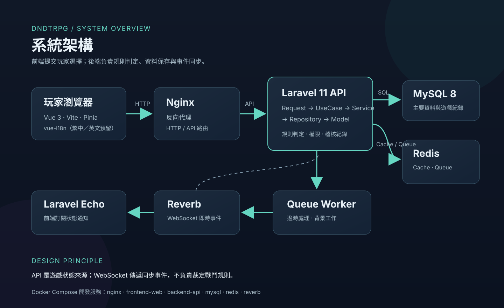

# DNDTRPG 公開展示

DNDTRPG 是面向繁體中文玩家的 DND 5E inspired 文字地城 RPG。玩家建立角色、進入回合制戰鬥與分支副本；後端負責擲骰、命中、傷害、獎勵與狀態保存。

> 展示狀態基準截至專案最後一筆交接紀錄 2026-07-03；不是 2026-10-15 當日重新執行的驗證。產品目前定位為五日小規模封閉玩測準備，尚未公開公測或達到 v1.0。

## 技術架構

- 前端：Vue 3、Vite、Pinia、vue-i18n。
- 後端：Laravel 11，依 Request、UseCase、Service、Repository 分層。
- 資料：MySQL 8；Redis 用於快取與佇列。
- 即時：Laravel Reverb、Echo、WebSocket；API 仍是遊戲狀態來源。
- 開發環境：Docker Compose，含 Nginx、前端、後端、MySQL、Redis、Reverb。

## 遊戲操作畫面

目前尚未提供可公開使用的實際操作截圖。預計補上角色列表、副本列表、黑牙分支路線、戰鬥操作、結算獎勵及 Admin Review Console 畫面。截圖需使用去識別化展示帳號，遮蔽 email、token、個資及內部識別碼；不以生成圖或美術參考圖冒充實機畫面。

## AI Agent 協作與問題解決案例

### 模擬配裝造成資料庫死結

平行地城模擬沿用正式商店購買與裝備穿戴流程，競爭 `character_equipment`、`equipment_instances`、`equipment_logs` 等資料列鎖。被死結污染的模擬報告不能用於判斷副本平衡。

Agent 先唯讀比對交易邊界、Repository 查詢與歷史錯誤，將根因定位到模擬配裝的交易鎖順序及寫入熱點，而非副本難度。修正採穩定鎖定角色、商店商品與既有裝備欄位的順序，再完成購買與穿戴；保留持有權檢查、金幣處理與稽核紀錄，並加入聚焦測試。

修正降低了死結風險，但不代表消除所有平行模擬風險。後續隔離平行冒煙只完成 dry-run 與安全前置檢查，沒有採計真實平行結果；正式平衡模擬維持序列執行。

Agent 開發閉環：讀規格與狀態 → 建立小範圍任務 → 對照程式與證據 → 定位根因 → 最小修正 → 聚焦測試 → 記錄限制與結果。AI 協助開發與文件整理，命中、傷害、獎勵等遊戲規則仍由後端裁定；AI DM 尚未上線。

## 自動化測試與驗收

以下是專案文件內可追溯的歷史結果，不代表此次展示資料上傳時重新執行：

- 2026-06-12 後端完整測試：589 tests、56,241 assertions，使用隔離測試資料庫 `dndtrpg_testing`。
- 同日 Vite 前端建置通過。
- 2026-06-29 黑牙正式裝備掉落矩陣六個職業／等級格均達各自低標，`simulation_error_count=0`；例如戰士 Lv2 0.8546、牧師 Lv2 0.7212、法師 Lv2 合併 0.7023。
- 四主題副本正式序列模擬八條 5,000-run 報告皆 `simulation_error_count=0`；暮影墓園第三輪補證的滿裝完成率 0.9770、建議配裝 0.9000。
- 黑牙三選一路線完成工程與人工遊玩驗收，紀錄涵蓋路線、戰鬥、獎勵、背包與後台唯讀追查。
- 2026-06-29 封閉玩測準備稽核結論為 **Conditional GO（有條件可進入準備階段）**，仍待發布決策；不代表已邀請玩家或可公開公測。

## 功能現況

| 領域 | 已完成／可展示 | 尚未完成／限制 |
| --- | --- | --- |
| 帳號與角色 | 註冊／登入、角色建立與查詢 | 真實 Google 登入仍需部署端 OAuth 機密與回呼驗收 |
| 戰鬥 | 單人 PvE、擲骰、攻擊、防禦、閃避、逃脫、道具行動、狀態效果 | 完整法術系統與 `cast_spell` Phase C 未完成 |
| 副本 | 教學副本、黑牙三選一路線、四主題副本與結算 | 完整格狀迷宮、座標移動與部分隨機副本正式化規則未完成 |
| 多人 | Party／多人戰鬥與 WebSocket 同步底層 | 玩家端隊伍入口暫時顯示未開放 |
| 獎勵與背包 | 完成獎勵、completion drop、背包查詢、道具使用與稽核紀錄 | Reward node、claim_reward、完整正式掉落表與中途獎勵未完成 |
| 裝備與商店 | MVP 穿戴／卸下、NPC 商店買賣與交易紀錄 | 完整武器熟練、稀有度、強化、玩家交易市場未完成 |
| 管理觀測 | Admin Review Console 第一版唯讀查詢 | 正式營運 CRUD、補發／修正工具未完成 |
| AI | Agent 開發協作與 AI 敘事冒煙驗收 | AI DM、GM 工具未上線，AI 不裁定遊戲規則 |

## 專案來源與證據

- [原始專案](https://github.com/kuangltw/dndtrpg)
- [封閉玩測準備文件](https://github.com/kuangltw/dndtrpg/blob/main/docs/FIVE_DAY_CLOSED_TEST_READINESS.md)
- [封閉玩測狀態稽核](https://github.com/kuangltw/dndtrpg/blob/main/docs/tasks/done/2026-06/2026-06-29-five-day-closed-test-cgs-readiness-audit-after-formal-balance.md)
- [死結根因稽核](https://github.com/kuangltw/dndtrpg/blob/main/docs/tasks/done/2026-06/2026-06-10-simulation-loadout-deadlock-root-cause-readonly-audit.md)
- [鎖順序修復紀錄](https://github.com/kuangltw/dndtrpg/blob/main/docs/tasks/done/2026-06/2026-06-10-simulation-loadout-lock-order-fix.md)
- [完整測試與封測驗收紀錄](https://github.com/kuangltw/dndtrpg/blob/main/docs/tasks/done/2026-06/2026-06-12-five-day-closed-test-rc-go-no-go-refresh.md)
